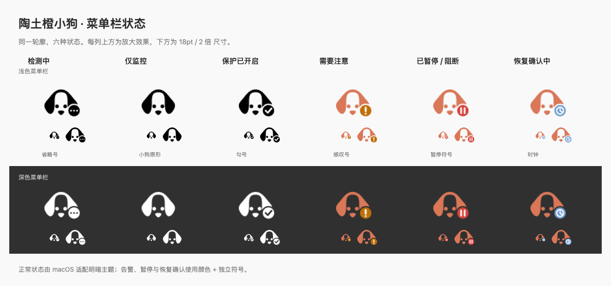

# 陶土橙小狗菜单栏图标

应用图标采用暖白底、陶土橙耳朵与炭黑五官，文件为 `resources/icon.png`，圆角底板外必须保持透明，避免通知图标出现外层白色方框。菜单栏图标由 `icon.go` 的曲线绘制，状态由 `icon_state.go` 根据当前检测快照选择。

| 文件前缀 | 状态 | 符号 |
|---|---|---|
| `checking` | 检测中 | 省略号 |
| `monitoring` | 正常，仅监控 | 无角标 |
| `protected` | 正常，保护已开启 | 勾号 |
| `warning` | 出口、检测或保护需要注意 | 感叹号 |
| `paused` | 已暂停进程或阻断流量 | 暂停 |
| `recovering` | 恢复确认中 | 时钟 |

导出的 macOS PNG 为透明背景、64 × 48 像素。MyGo 将整张图显示为 18pt 高，小狗轮廓约 15.5pt 高；横向画布保留垂耳比例，并为角标留出空间。`-template` 文件是正常状态的透明模板，符号使用透明镂空；`-color` 文件用于彩色警示状态。Windows 运行时使用同一绘制代码生成 64 × 64 像素的方形版本，适配通知区。运行时直接生成图标，这些 PNG 是供设计查看和复用的导出文件。

保留垂耳轮廓和五官，去掉应用图标的白色底座与阴影。状态角标与狗形之间留出透明间隔，小尺寸下仍可辨认。所有状态尺寸固定且无动画。

仅有保护开关开启不足以显示节点保护成功；还要确认各条正常路线已锁定，且没有相关保护错误。恢复确认不会提前解除保护。历史连接断开计数不代表当前处于暂停状态。

彩色版本的狗形使用陶土橙 `#D97757`；告警角标为琥珀色，暂停角标为红色，恢复角标为蓝色 `#6A9BCC`。macOS 普通状态仍使用随系统明暗适配的模板图标。
